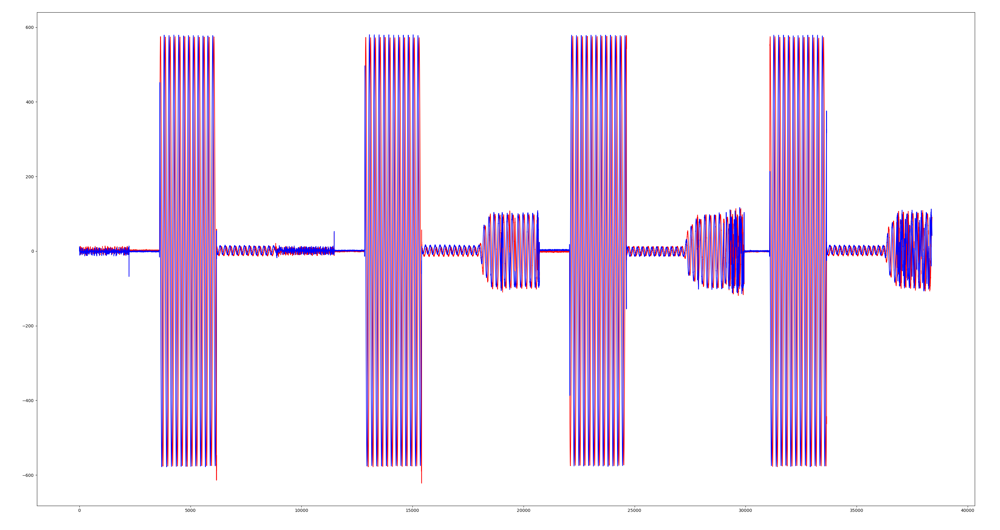
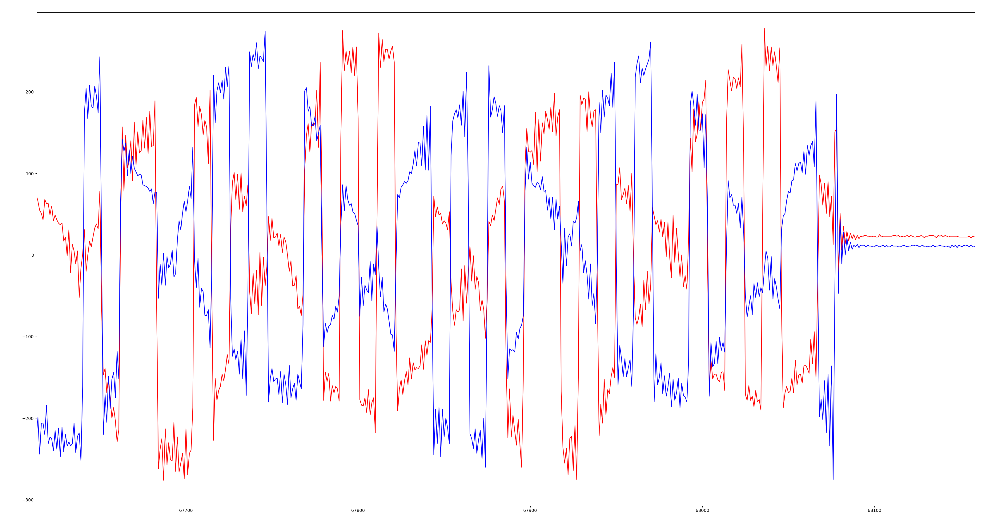

# Отчёт по учебной практике

## **Занятия №4–5**

---

## 1. Лекционная часть
**Тема:** Знакомство с библиотеками Soapy SDR, Libiio для работы с Adalm Pluto SDR. Инициализация SDR-устройства. Работа с буфером: получение цифровых IQ-отсчетов. Прием-передача сэмплов на 2 SDR.

В этой работе мы настраивали прямую связь между двумя устройствами Adalm-Pluto SDR на языке C++ с помощью библиотеки SoapySDR. Основная задача — организовать передачу сигнала с одного устройства и его приём на другом, используя разные частоты и работу с буферами отсчётов.

---

### Настройка частот приёма и передачи

Чтобы передатчик и приёмник на устройствах не глушили друг друга, мы разнесли частоты для двух плат:
* **SDR 1:** приём на **890 МГц**, передача на **800 МГц**
* **SDR 2:** приём на **800 МГц**, передача на **890 МГц**

Получается перекрёстная схема: первый SDR передаёт сигнал на 800 МГц, а второй SDR ловит его на этой же частоте.

---

### Форма передаваемого сигнала

В SDR сигнал формируется из двух составляющих: $I$ (синфазная) и $Q$ (квадратурная). 
В коде мы задаём простой прямоугольный импульс длиной 200 отсчётов с постоянными уровнями $I$ и $Q$.

Передача идёт циклически периодами по 40 буферов:
* **20 буферов** передатчик включен и отправляет импульсы в эфир;
* **20 буферов** передатчик выключен (в эфире пауза);
* далее цикл повторяется.

---

### Основные фрагменты кода

#### 1. Подключение и инициализация SDR
Этот блок находит и открывает устройство по его адресу (USB или IP), задавая размер буфера с метками времени:

```cpp
SoapySDRKwargs args = {};
SoapySDRKwargs_set(&args, "driver", "plutosdr");
SoapySDRKwargs_set(&args, "uri", uri);
SoapySDRKwargs_set(&args, "direct", "1");
SoapySDRKwargs_set(&args, "timestamp_every", "1920");
SoapySDRKwargs_set(&args, "loopback", "0");

sdr = SoapySDRDevice_make(&args);
SoapySDRKwargs_clear(&args);
```

#### 2. Настройка параметров приёма (RX)
Этот фрагмент кода отвечает за назначение характеристик RX антенны: частоты дискретизации, несущей частоты приёма и чувствительности (усиления):

```cpp
if (SoapySDRDevice_setSampleRate(sdr, SOAPY_SDR_RX, 0, SAMPLE_RATE) != 0) {
    fprintf(stderr, "Ошибка настройки RX sample rate: %s\n", SoapySDRDevice_lastError());
    goto cleanup;
}
if (SoapySDRDevice_setFrequency(sdr, SOAPY_SDR_RX, 0, rx_freq, NULL) != 0) {
    fprintf(stderr, "Ошибка настройки RX частоты: %s\n", SoapySDRDevice_lastError());
    goto cleanup;
}
if (SoapySDRDevice_setGain(sdr, SOAPY_SDR_RX, 0, RX_GAIN) != 0) {
    fprintf(stderr, "Предупреждение: ошибка настройки RX gain: %s\n", SoapySDRDevice_lastError());
}
```

#### 3. Настройка параметров передачи (TX)
Здесь задаются параметры передатчика: частота дискретизации, частота передачи и мощность сигнала:

```cpp
if (SoapySDRDevice_setSampleRate(sdr, SOAPY_SDR_TX, 0, SAMPLE_RATE) != 0) {
    fprintf(stderr, "Ошибка настройки TX sample rate: %s\n", SoapySDRDevice_lastError());
    goto cleanup;
}
if (SoapySDRDevice_setFrequency(sdr, SOAPY_SDR_TX, 0, tx_freq, NULL) != 0) {
    fprintf(stderr, "Ошибка настройки TX частоты: %s\n", SoapySDRDevice_lastError());
    goto cleanup;
}
if (SoapySDRDevice_setGain(sdr, SOAPY_SDR_TX, 0, TX_GAIN) != 0) {
    fprintf(stderr, "Предупреждение: ошибка настройки TX gain: %s\n", SoapySDRDevice_lastError());
}
```

#### 4. Создание и запуск потоков RX и TX
Создаются потоки данных для приёма и передачи 16-битных сэмплов (`CS16`), после чего они активируются:

```cpp
rxStream = SoapySDRDevice_setupStream(sdr, SOAPY_SDR_RX, SOAPY_SDR_CS16, channels, 1, NULL);
SoapySDRDevice_activateStream(sdr, rxStream, 0, 0, 0);

txStream = SoapySDRDevice_setupStream(sdr, SOAPY_SDR_TX, SOAPY_SDR_CS16, channels, 1, NULL);
SoapySDRDevice_activateStream(sdr, txStream, 0, 0, 0);
```

#### 5. Выделение памяти под буферы
Узнаём у устройства максимальный размер пакета (MTU) и выделяем память под массивы отсчётов приёма и передачи:

```cpp
rx_mtu = SoapySDRDevice_getStreamMTU(sdr, rxStream);
rx_buffer = (int16_t *)malloc(2 * rx_mtu * sizeof(int16_t));

tx_mtu = SoapySDRDevice_getStreamMTU(sdr, txStream);
tx_buff = (int16_t *)malloc(2 * tx_mtu * sizeof(int16_t));
```

#### 6. Формирование импульса и отправка в эфир
Код чередует 20 буферов передачи и 20 буферов паузы. Во время передачи заполняется прямоугольный импульс на 200 отсчётов и отправляется на антенну:

```cpp
size_t phase = buffers_read % 40;
bool tx_on = (phase >= 2 && phase < 22);

memset(tx_buff, 0, 2 * tx_mtu * sizeof(int16_t));

if (tx_on) {
    for (size_t i = 0; i < 200 && i < tx_mtu; i++) {
        tx_buff[2*i]     = 2000 << 4;
        tx_buff[2*i + 1] = 2000 << 4;
    }
}

void *tx_buffs[] = {tx_buff};
int tx_flags = 0;
long long tx_time = 0;

int st = SoapySDRDevice_writeStream(
    sdr, txStream,
    (const void * const *)tx_buffs,
    tx_mtu, &tx_flags, tx_time, timeoutUs);
```

#### 7. Чтение сигнала из эфира и запись в файл
Считываем буфер из приёмника и записываем полученные отсчёты в бинарный файл:

```cpp
void *rx_buffs[] = {rx_buffer};
int flags = 0;
long long timeNs = 0;

int sr = SoapySDRDevice_readStream(sdr, rxStream, rx_buffs, rx_mtu, &flags, &timeNs, timeoutUs);
if (sr > 0) {
    fwrite(rx_buffer, 2 * sizeof(int16_t), (size_t)sr, file);
}
```

---

## 2. Практическая часть
**Ход работы**

Для выполнения работы потребовалось:
* Два устройства **Adalm-Pluto SDR** (`sdr1` и `sdr2`), подключенные по USB;
* Ноутбук с операционной системой **Ubuntu Linux**;
* Библиотека SoapySDR и написанный C++ проект;
* Python-скрипт для открытия файла с отсчётами и построения графиков.

### Как выполнялась работа:
1. Подключили обе платы PlutoSDR к портам USB и узнали их адреса.
2. Запустили программу для `sdr1` в режиме передачи пачек импульсов на частоте **800 МГц**.
3. В отдельном терминале запустили программу для `sdr2` в режиме приёма на той же частоте **800 МГц**.
4. Приёмник `sdr2` записал принятый поток отсчётов в файл `sdr2_rxdata.pcm`.
5. С помощью Python-скрипта прочитали этот файл и отобразили графики $I$ и $Q$ составляющих.

---

### Анализ графиков

#### 1. Общий вид принятого сигнала
На графике показан приём серии пачек импульсов на протяжении 40 000 сэмплов:



* **Видны чёткие пачки:** Сигнал идёт строго с периодом, как мы и задавали в коде: пачка импульсов, затем пауза (тишина около нуля), снова пачка. Это подтверждает правильную работу цикла (20 буферов передача, 20 буферов пауза).
* **Хороший уровень сигнала:** Размах амплитуды составляет примерно $\pm 600$ отсчётов. Это оптимальный уровень для приёмника — сигнал достаточно сильный, но при этом нет перегрузки (верхушки сигнала не срезаются).
* **Вторичные отклики меньшей амплитуды:** Между высокими пачками видны небольшие импульсы с амплитудой около 100 отсчётов. Это нормальный физический эффект: переотражения сигнала от стен в помещении и срабатывание автоматической регулировки усиления (АРУ) приёмника при появлении импульса.

---

#### 2. Детальный вид сигнала (увеличенный масштаб)
На этом графике показан один из импульсов в приближенном масштабе:



* **Синяя ($I$) и красная ($Q$) линии:** Наглядно видно разделение квадратурных составляющих принятого радиосигнала.
* **Форма импульса:** Отчётливо видны резкие переходы уровней, что характерно для прямоугольного импульса.
* **Конец передачи пачки:** Около отметки 68 080 передача пачки резко прекращается, и сигнал сразу падает в ноль. После этого остаётся лишь маленькое постоянное смещение нуля ($Q \approx 20$, $I \approx 10$), что типично для радиоприёмников в паузах между передачами.

---

## Итог:
В ходе занятий №4–5 мы настроили приём и передачу между двумя устройствами Adalm-Pluto SDR на C++ с использованием библиотеки SoapySDR. Разнесли частоты приёма и передачи (800 МГц и 890 МГц), чтобы устройства не мешали друг другу, и передали пачки прямоугольных импульсов. 

Полученные графики подтвердили, что сигнал успешно передаётся по радиоканалу, сохраняет прямоугольную форму и стабильно принимается вторым устройством.
