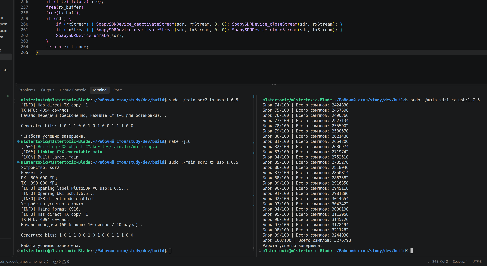
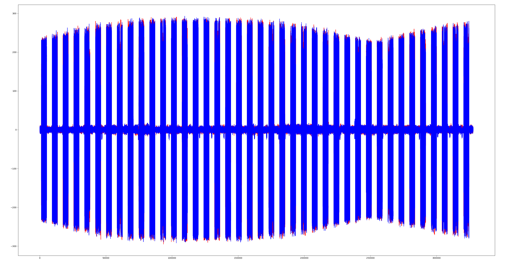
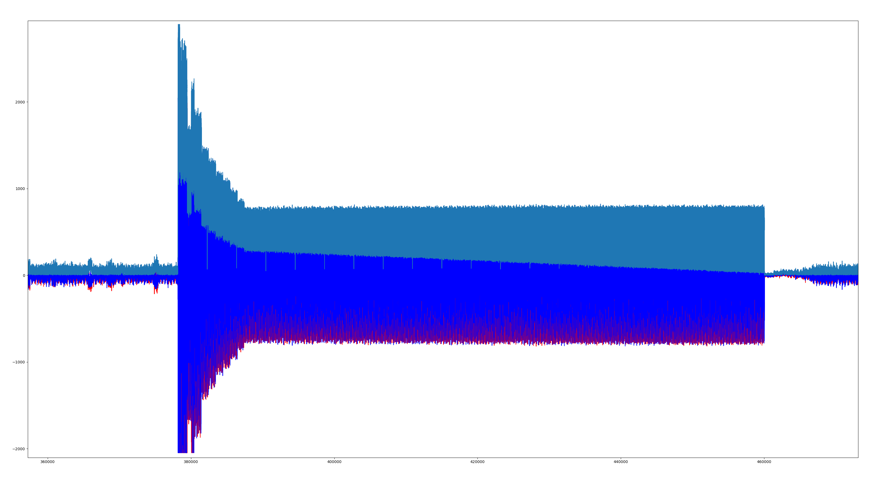
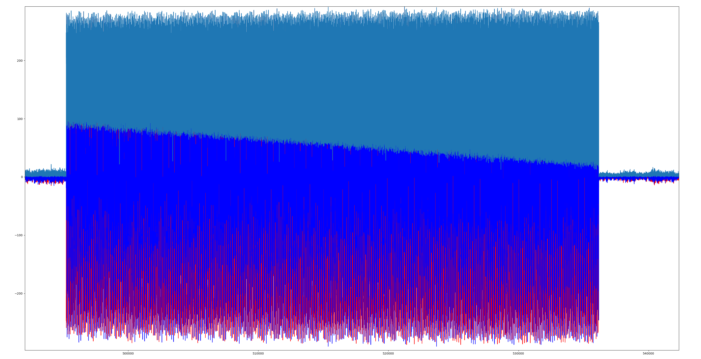
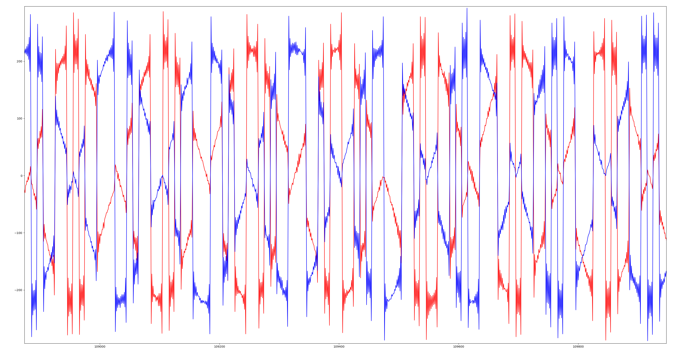
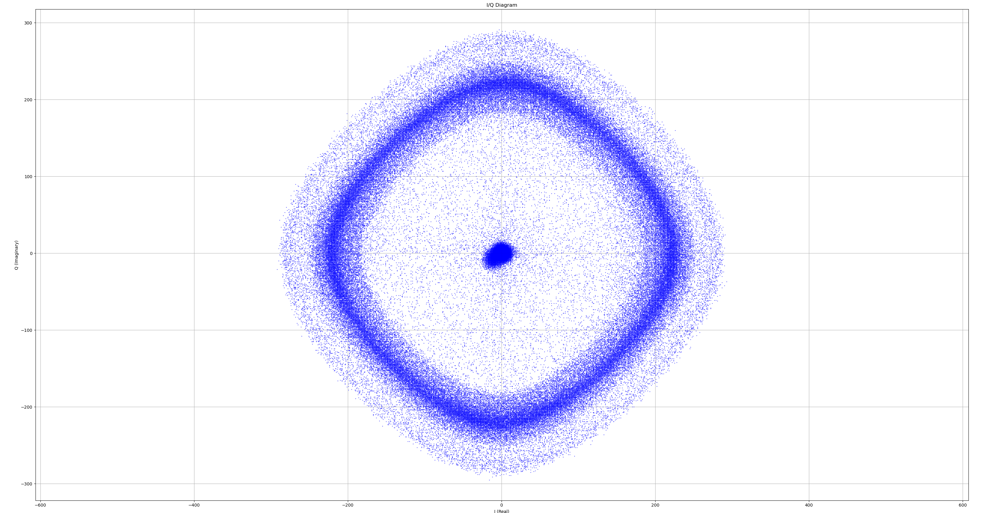

# Отчёт по учебной практике

## **Занятия №6–8**

---

## 1. Лекционная часть
**Тема:** Архитектура SDR-устройств. Разработка цифрового передатчика: формирование битовой последовательности, модуляция BPSK, вставка нулей (Upsampling) и дискретная свёртка. Приёмный тракт: захват IQ-отсчётов, устранение всплесков сигнала и анализ диаграммы созвездия.

В рамках занятий №6–8 на базе библиотеки **SoapySDR** (язык C++) был реализован полноценный конвейер цифрового передатчика для платы Adalm-Pluto SDR и организован приём сформированного радиосигнала на второе SDR-устройство.

---

## 2. Практическая часть

### Трудности в процессе работы и их решение (было → стало)

1. **Тестовый меандр и случайные биты → Фиксированная последовательность и цифровой тракт BPSK**
   * *Как было:* На первых занятиях вместо полезных данных передавался простой тестовый сигнал (переключение $+20000 / -20000$ каждые 64 отсчёта в оба канала $I$ и $Q$). Когда перешёл к генерации бит, сначала попробовал случайный генератор `rand() % 2`.
   * *Проблема:* При случайной последовательности на приёмнике невозможно заранее знать, какие именно данные передавались в эфир.
   * *Решение:* Заменил случайную генерацию на жёстко заданный массив из 16 бит: `1 0 1 1 0 0 1 0 1 0 0 1 1 1 0 0`. После этого реализовал BPSK-модуляцию ($\pm 20000$ в канал $I$, $0$ в канал $Q$), добавил вставку нулей (по 10 отсчётов на символ) и применил дискретную свёртку с фильтром из 10 единиц для формирования прямоугольных импульсов.

2. **Огромный всплеск в начале каждого пакета**
   * *Проблема:* На первых графиках в самом начале каждого пакета появлялся резкий выброс амплитуды (почти до $+3000$ по модулю при полезном уровне около $\pm 800$), который искажал масштаб графика.
   * *Причина:* В коде приёмника было включено автоматическое усиление (`SoapySDRDevice_setGainMode(..., true)`). Во время паузы между пакетами в эфире была тишина, и приёмник автоматически выкручивал чувствительность на максимум. Когда резко начинался пакет, входной тракт на доли секунды уходил в перегруз, пока автоматика не снижала усиление обратно.
   * *Решение:* Автоматический режим выключил (`false`) и вручную выставил постоянное усиление `50.0` дБ (`SoapySDRDevice_setGain`). После этого всплески полностью пропали, а пакеты стали ровными с первого отсчёта.

3. **Укорачивание пакетов: от `20/20` через тест с 60 блоками к режиму «1 сигнал / 1 пауза»**
   * *Как было:* Изначально передатчик чередовал 20 буферов передачи и 20 буферов тишины — пачки получались слишком широкими (около 82 тыс. отсчётов).
   * *Проблема:* При первом переходе на более короткие пачки (`10 сигнал / 10 пауза`) цикл передатчика временно ограничил 60 блоками. Из-за этого передатчик отправлял всё за долю секунды и сразу завершался, тогда как приёмник продолжал ждать свои 100 блоков.
   * *Решение:* Передатчик вернул в режим непрерывной работы до нажатия `Ctrl+C`, а затем сократил чередование до минимального шага: `1 буфер сигнала / 1 буфер паузы` (`buffers_written % 2 == 0`). В результате на графике получилась компактная и наглядная периодическая серия пакетов.

4. **Долгая отрисовка графиков в Python (100 буферов → 50 → 20 → 10)**
   * *Как было:* Приёмник записывал 100 буферов (`RX_ITERATION_COUNT 100`, около 3.28 млн отсчётов при размере буфера RX MTU = 32 768).
   * *Проблема:* Скрипт `scrining.py` при построении такого объёма данных тратил много времени на отрисовку, а масштабирование в окне сильно тормозило.
   * *Решение:* Длину записи последовательно уменьшил: сначала в 2 раза (до `50` буферов), затем до `20` (~655 тыс. отсчётов), а в итоговой версии кода остановился на **`10` буферах** (~328 тыс. отсчётов). Этого объёма хватает, чтобы увидеть десятки пакетов, а графики в Python стали открываться и приближаться мгновенно.

5. **Упрощение временного графика и отдельный скрипт для созвездия**
   * *Как было:* В скрипте `scrining.py` вместе с каналами $I$ и $Q$ рисовалась третья кривая — модуль комплексного сигнала (`np.abs(iq)`), а графика созвездия не было.
   * *Решение:* Убрал построение модуля с временного графика, оставив только $I$ и $Q$, а для анализа фазовой плоскости вынес отрисовку созвездия в отдельный скрипт `I_Q.py`.

---

### Анализ графиков

#### 1. Одновременный запуск передачи и приёма в терминале
На снимке экрана показана совместная работа двух устройств в Ubuntu Linux:

* **Слева (передатчик sdr2):** завершение предыдущего бесконечного запуска по `Ctrl+C`, пересборка (`make -j16`) и запуск тестового варианта с выводом 16 бит `1 0 1 1 0 0 1 0 1 0 0 1 1 1 0 0`, размером буфера TX MTU = 4094 отсчёта и частотой передачи 890 МГц.
* **Справа (приёмник sdr1):** приём данных на частоте 890 МГц с выводом прогресса в консоль и сохранением в файл `sdr1_rxdata.pcm`.

> *Примечание:* Данный снимок экрана был сделан в процессе отладки — на промежуточном этапе, когда передатчик временно тестировал с ограничением `60 блоков: 10 сигнал / 10 пауза` (поэтому слева он уже завершился), а приёмник справа ещё принимал `100` буферов (3 276 798 отсчётов). Позже передатчик вернул в бесконечный режим до нажатия `Ctrl+C` и перешёл к чередованию `1 к 1`, а на приёмнике сократил запись через 50 и 20 до итоговых `10` буферов. Сам принцип запуска и взаимодействия устройств при этом не изменился.

---

#### 2. Общий вид принятого сигнала (режим «1 сигнал / 1 пауза»)
На итоговом графике показана запись из 10 буферов приёма (около 328 тыс. отсчётов):

* Пакеты идут со строгой периодичностью: за каждым буфером сигнала следует зона тишины (нулевой буфер), пакеты не сливаются друг с другом.
* Всплески перегруза отсутствуют: амплитуда держится в рабочем диапазоне (порядка $\pm 230\text{–}290$), а плавное волнообразное изменение огибающей по длине записи связано с медленным уходом фазы между двумя устройствами.

---

#### 3. Всплеск в начале пакета и результат его устранения
На приближенном графике показан начальный артефакт автоматического усиления:

* Отчётливо виден начальный скачок и спадающий «хвост» выброса амплитуды до момента стабилизации уровня.
* После перехода на ручное усиление 50.0 дБ сигнал стал прямоугольным сразу с первого отсчёта пачки:

> *Примечание:* На обоих этих графиках поверх каналов $I$ (синий) и $Q$ (красный) ещё отображается голубая линия модуля сигнала (`np.abs(iq)`), которую позже отключил в `scrining.py`. Кроме того, снимок со всплеском был сделан при ранней ширине пакета `20` буферов (~82 тыс. отсчётов, уровень ~800), а график после отключения автоматики — на этапе `10` буферов (~41 тыс. отсчётов, уровень ~280).

---

#### 4. Детальный вид принятых символов во времени
На приближенном графике показан фрагмент итогового принятого сигнала во временной области ($I$ — синий, $Q$ — красный):

* **Фазовые скачки:** на графике видны резкие вертикальные переходы и смена полярности сигналов — это моменты переворота фазы на 180°, происходящие при смене передаваемого бита ($1 \rightarrow 0$ или $0 \rightarrow 1$).
* **Биения частоты:** между скачками фазы сигнал имеет плавную синусоидальную форму и перетекает между каналами $I$ и $Q$. Это естественный физический эффект: у двух разных плат PlutoSDR частоты опорных генераторов слегка отличаются (разница в сотни герц), из-за чего принятый сигнал в эфире непрерывно «плывёт» по фазе до тех пор, пока в приёмнике не будет реализован алгоритм частотной синхронизации.

---

#### 5. График созвездия I/Q и разработка отдельного скрипта
Чтобы не загромождать основной скрипт временной развёртки `scrining.py`, для отображения фазовой плоскости был написан отдельный файл `I_Q.py`. В нём реализовано векторное чтение файла `build/sdr1_rxdata.pcm` через `numpy.fromfile`, разделение каналов срезами `data[0::2]` и `data[1::2]`, а также точечная отрисовка на плоскости I/Q (`plt.axis('equal')`):

* **Точка в центре $(0, 0)$:** соответствует нулевым буферам тишины (паузам между передачами).
* **Вращающееся кольцо:** в теории созвездие BPSK представляет собой две неподвижные точки на вещественной оси. Но из-за описанной выше разницы частот между двумя платами PlutoSDR вектор фазы непрерывно вращается, и точки созвездия на плоскости разворачиваются в окружность радиусом около 220 отсчётов.
